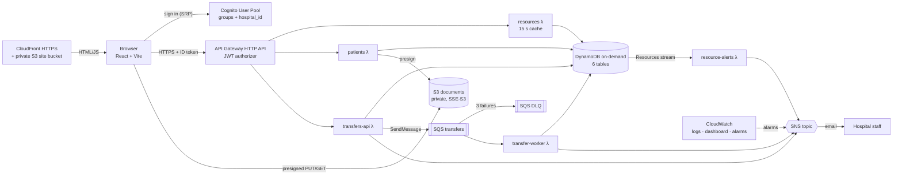
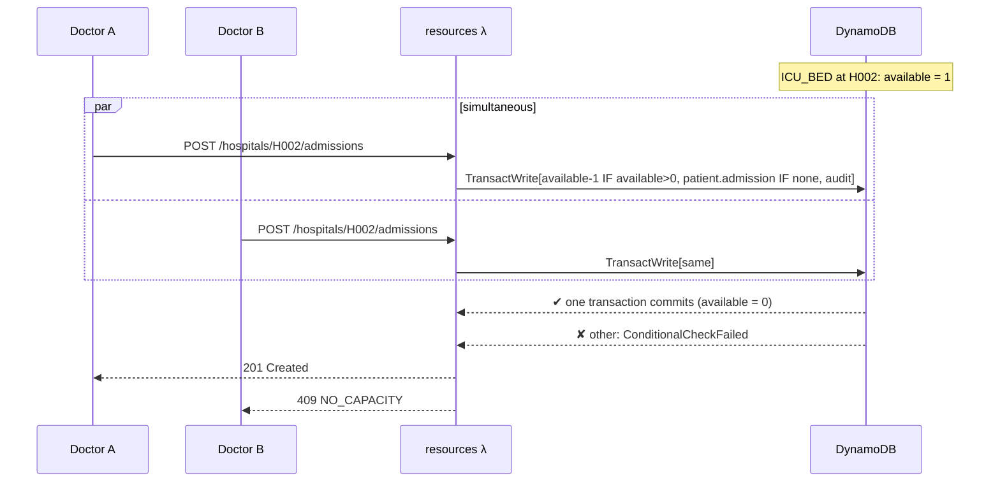
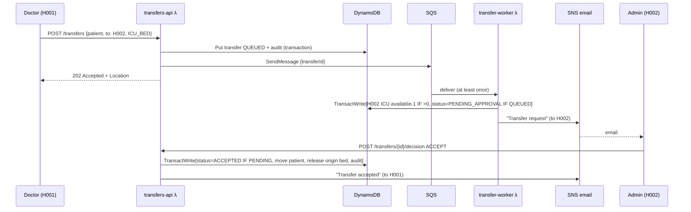

# Architecture: HealthCloud

A serverless AWS system in which hospitals of one chain share **synthetic** patient records and track
ICU beds, general beds and ventilators in real time, with emergency transfers and alerts.
Everything is pay-per-request, so the system costs nothing while idle and stays inside the AWS Free plan.

## 1. Overview

| Layer | Service | Why this choice |
|---|---|---|
| Hosting | S3 (private) + CloudFront with Origin Access Control | HTTPS on a global CDN. HTTPS is required for the browser SRP crypto. Free tier: 1 TB and 10M requests a month |
| Identity | Cognito User Pool (Lite tier) | Managed sign-in. Groups give roles, and a custom attribute carries `hospital_id`. Free up to 10k monthly users |
| API | API Gateway **HTTP API** | Cheaper and faster than REST API. A built-in JWT authorizer validates Cognito tokens with no code |
| Compute | 6 Go Lambdas, arm64, `provided.al2023` | Go cold-starts fast and uses little memory (128 MB). arm64 is cheaper per ms |
| Data | DynamoDB on-demand | No servers and no idle cost. **Conditional writes and transactions** make bed booking race-safe |
| Files | S3 + presigned URLs | Files bypass Lambda (no 6 MB payload limit, less compute). The bucket stays private |
| Async | SQS + DLQ | Absorbs bursts of transfer requests. Failed messages are kept for inspection, never lost |
| Alerts | DynamoDB Streams → Lambda → SNS email | Every path that changes a bed count is covered automatically |
| Ops | CloudWatch Logs (JSON), dashboard, alarms | One place to see traffic, errors, queue depth and rejected overbookings |

## 2. Security model

1. **Authentication**: Cognito issues an ID token after SRP sign-in (the password never crosses the
   wire in plain text). API Gateway's JWT authorizer checks signature, expiry, issuer and audience
   **before** any Lambda runs. Invalid tokens get 401 from API Gateway.
2. **Authorization in the Lambda, from verified claims** (`backend/internal/auth`):
   - **Patient**: only their own record and documents (`patientId == sub`)
   - **Doctor**: any patient in the chain (that's the point of sharing). Every read is **audited
     before** data is returned, and if the audit write fails the read fails (*fail closed*)
   - **HospitalAdmin**: only their own `hospital_id`'s resources. Decides only transfers *into* their hospital
   - The frontend hides tabs for convenience only. Every rule is enforced server-side and unit-tested
3. **Data protection**: DynamoDB is encrypted at rest (AWS-owned key). S3 uses SSE-S3 with Block Public
   Access, ACLs disabled and a TLS-only bucket policy. SQS uses SSE-SQS. Presigned URLs last 5 minutes,
   cover one object, and are bound to the declared Content-Type. S3 keys are chosen by the server and
   file names are sanitised.
4. **Least privilege IAM**: each function gets only the actions it uses. The audit log is
   `PutItem`-only, so the code physically cannot edit or delete history.
5. **No PHI outside the database**: logs and emails carry IDs and counts only. All data is synthetic.
6. **Users can't change their own hospital**: `custom:hospital_id` is not writable by the app client,
   and self sign-up is disabled.

## 3. Key flows

### 3.1 Race-safe admission (the core guarantee)

DynamoDB evaluates the condition and applies the update **atomically per item**, so two requests can
never both see `available = 1`. Reading the count in code and then writing it back would have exactly
that race. Concurrent transactions on the same item may be cancelled with `TransactionConflict` (nothing
is written). Those requests retry with jittered backoff until they either succeed or meet a real
condition failure.

**Proof** (`backend/internal/db/admissions_integration_test.go`, run against DynamoDB Local and in CI):

| Scenario | Result (repeated 5×) |
|---|---|
| 50 concurrent requests, 1 free bed | 1 admitted, 49 `NO_CAPACITY`, available = 0 |
| 40 concurrent requests, 5 free beds | 5 admitted, 35 `NO_CAPACITY`, available = 0 |
| Same patient, 10 concurrent clicks, 5 free beds | 1 admitted, 9 `ALREADY_ADMITTED`, available = 4 |

### 3.2 Emergency transfer (asynchronous)

- **Idempotent worker**: the `status = QUEUED` condition means a duplicate SQS delivery does nothing.
  The test fires 10 concurrent deliveries of one message and exactly 1 bed is held.
- **No lost requests**: the row is stored *before* enqueueing. If SQS fails, the row is marked `FAILED`.
  Messages that fail 3 times go to the DLQ, and the DLQ alarm emails the team.
- **Partial batch responses**: only failed messages are retried, never a whole batch.

### 3.3 Document upload and download

1. Doctor `POST /patients/{id}/documents` → the API stores `PENDING_UPLOAD` metadata and an audit entry,
   then returns a presigned **PUT** URL (5 min, Content-Type bound).
2. The browser `PUT`s the file **directly to S3**.
3. Doctor `POST …/complete` → the API checks the object exists (`HeadObject`) and is ≤ 10 MB (oversized
   files are deleted), then marks it `AVAILABLE`.
4. Reading: `GET …/documents/{docId}` → the audit entry is written first, then a presigned **GET** URL is returned.

### 3.4 Low-resource alerts

Every change to a `Resources` row goes to the table's stream. `resource-alerts` emails only when
availability **crosses** below the threshold (`old ≥ threshold > new`), so there is one email per
incident rather than one per bed.

### 3.5 Availability cache

`GET /resources` (the chain-wide dashboard) is served from a 15-second in-memory cache inside the
`resources` Lambda container. No Redis or ElastiCache is needed. Writes in the same container
invalidate it. The response's `cachedAt` makes the staleness visible. Bookings never read from
the cache; their correctness comes from the conditional write.

## 4. Data model

Six DynamoDB tables, each keyed for its main access pattern, with 7 GSIs. Every access pattern is a
`GetItem` or `Query`, except two `Scan`s over tiny tables (hospitals, and the cached availability view).
See [DATA_MODEL.md](DATA_MODEL.md).

## 5. Cost (AWS Free plan)

| Service | Always-free allowance | Demo usage |
|---|---|---|
| Lambda | 1M requests + 400k GB-s / month | thousands of requests at 128 MB |
| DynamoDB | 25 GB storage, Streams reads by Lambda free | KBs of synthetic data; on-demand requests ≈ $0.0000013 each |
| SQS / SNS | 1M requests each; 1,000 emails | tens |
| Cognito Lite | 10,000 monthly active users | 13 demo users |
| CloudFront | 1 TB transfer + 10M requests / month | a few MB |
| CloudWatch | 3 dashboards, 10 alarm metrics, 5 GB logs | 1 dashboard, 7 alarm metrics, 7-day retention |
| API Gateway HTTP API, S3 | pay-per-request (about $1 per million API calls; GB-month storage) | thousands of calls, a few MB |

On the AWS Free plan, any tiny pay-per-request charges (API Gateway, S3, DynamoDB requests) are
drawn from the account's free credits. Expected spend for the demo is effectively $0. Nothing is
billed while idle, and the API throttle (25 req/s) caps runaway usage.

Deliberately **not used**: RDS/Aurora, ElastiCache, VPC/NAT, EC2, customer-managed KMS keys, SMS,
and provisioned capacity of any kind.

## 6. Testing

| Level | What | Where |
|---|---|---|
| Unit | Claim parsing, router (401/403/404/500), every access rule, error mapping, cache TTL, alert crossing logic, worker retry and duplicate handling, file-name sanitising | `go test ./...` |
| Integration | Race safety, idempotent worker, accept/reject state machine, every query, index and pagination path on **DynamoDB Local** | `DYNAMODB_ENDPOINT=… go test ./internal/db -run Integration` |
| Load | Cached reads and an admission burst against the deployed API | `k6/` |
| CI | All of the above, plus `sam validate --lint`, `sam build`, frontend build and OpenAPI lint on every push | `.github/workflows/ci.yml` |

## 7. Limitations and future work

- Presigned PUT can't cap upload size, so size is enforced after upload (oversized files are deleted).
  A presigned **POST** policy could enforce it up front.
- Each Lambda container has its own cache, so different users can see slightly different (≤ 15 s old) availability.
- One SNS topic serves all hospitals. Per-admin subscriptions with a `hospitalId` filter policy would
  route each hospital's emails to its own staff.
- Held beds for transfers that are never decided stay held. A scheduled job could expire them.
- Phase 4 (optional): natural-language availability queries with Amazon Bedrock (Nova Micro).
