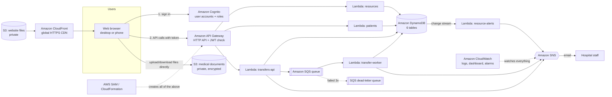

# HealthCloud: Cloud-Based Healthcare Resource and Medical Record Sharing System

**Project overview: features, AWS cloud services, how it works, and what makes it new**

> Live system: https://d2a85j4uiipyru.cloudfront.net · Region: AWS `us-east-1` · All data is synthetic (invented).

---

## 1. The problem, in one paragraph

Hospitals in the same healthcare chain often work like islands. One hospital doesn't know how many ICU beds or
ventilators the others have free right now. A patient's records sit in the system of the hospital they first
visited. During an emergency, staff phone around to find a bed, and two hospitals can promise the same last bed
to two different patients. **HealthCloud** puts every hospital in the chain on one shared cloud platform. Everyone
sees live bed and ventilator counts, doctors can open any patient's record from any hospital (and every access
is recorded), emergency transfers are requested and approved online, and staff get email alerts when a hospital
is running low. It is built entirely from **serverless AWS services**: there are no servers to manage, it scales
automatically, and it costs nothing when nobody is using it.

---

## 2. Who uses it

| Role | Who they are | What they can do |
|---|---|---|
| **Doctor** | Clinician at one hospital | See live capacity across all hospitals. Search and open **any** patient's record in the chain (every view is logged). Upload medical documents. Admit and discharge patients at **their own** hospital. Request emergency transfers to another hospital. |
| **Hospital admin** | Manager of one hospital | Edit their **own** hospital's bed, ICU and ventilator counts and alert thresholds. Accept or reject transfers **coming into** their hospital. Review every record access made by their staff. |
| **Patient** | A person receiving care | See **only their own** record and documents. See **who has looked at their record**, when, and from which hospital. |

Roles are enforced **in the cloud backend**, not just hidden in the website. Even someone who calls the API
directly can't do more than their role allows.

---

## 3. The big picture (architecture)



**In words:** the website is served worldwide over HTTPS by **CloudFront**. Users sign in with **Cognito**,
which gives the browser a signed token. Every request goes to **API Gateway**, which checks the token before
anything else runs, then hands the request to a small piece of code in **Lambda**. Lambda reads and writes data
in **DynamoDB**, stores files in **S3**, puts slow jobs on an **SQS** queue, and sends emails through **SNS**.
**CloudWatch** records logs and metrics and raises alarms. The whole setup (67 AWS resources) is
described in one file, `template.yaml`, and created automatically by **AWS SAM / CloudFormation**.

---

## 4. Every feature, explained

Each feature below covers **what it does**, **how it works step by step**, and **which AWS services make it work**.

### 4.1 Secure sign-in with roles

**What it does:** users sign in with email and password and land on a workspace tailored to their role.

**How it works:**
1. The browser sends the sign-in to **Amazon Cognito** using the **SRP protocol** (Secure Remote Password). The
   password itself never travels over the network, only a mathematical proof that the user knows it.
2. Cognito checks the password and returns a **JSON Web Token (JWT)**, a digitally signed "ID card" saying:
   *this is user X, they are in group "Doctor", and they belong to hospital H001*.
3. The browser attaches this token to every API request.
4. **API Gateway's JWT authorizer** verifies the token's signature, expiry and issuer **before** any code runs.
   Fake or expired tokens are rejected with 401 for free, without running any of our code.
5. Our Lambda code then applies the fine-grained rules ("a patient may only read their own record", "an admin may
   only edit their own hospital").

**Cloud features used:**
- **Cognito User Pool** (Lite tier, free up to 10,000 monthly users)
- **User groups** for roles: `Patient`, `Doctor` and `HospitalAdmin`
- A **custom attribute** `hospital_id`, which users cannot change themselves
- **Self sign-up disabled**: only the seeding script can create accounts, which is right for a hospital system
- The **API Gateway JWT authorizer**

### 4.2 Live capacity dashboard

**What it does:** shows, for every hospital, how many ICU beds, general beds and ventilators are free right now,
with colour-coded bars (green = fine, amber = low, red = full) and network-wide totals.

**How it works:**
1. The dashboard calls `GET /resources`.
2. The `resources` Lambda reads all capacity rows from the DynamoDB `Resources` table.
3. It keeps the result in a **15-second in-memory cache**. Lambda reuses the same running copy of the code for
   many requests in a row, so a burst of dashboard refreshes costs only one database read.
4. The page refreshes itself every 30 seconds, and shows when the data was read.

**Cloud features used:**
- **Lambda container reuse** as a free cache, instead of paying for a cache server like Redis or ElastiCache
- **DynamoDB on-demand**
- The response time is visible on the **CloudWatch** dashboard

### 4.3 Capacity management for hospital admins

**What it does:** an admin edits total beds, currently free beds and the alert threshold for their own hospital.

**How it works:** each capacity row has a **version number**. The admin's save includes the version they loaded.
DynamoDB only accepts the write **if the version is unchanged** (a *conditional write*). If a doctor admitted a
patient in the meantime, the version changed, so the admin's save is refused and the page reloads the fresh
numbers instead of silently overwriting the admission. This technique is called **optimistic locking**.

**Cloud features used:**
- **DynamoDB conditional writes**: the check and the write happen together, safely, inside the database
- The Lambda checks that the admin works at that hospital, using the `hospital_id` from their Cognito token

### 4.4 Race-safe bed admission (the core guarantee)

**What it does:** a doctor admits a patient to an ICU bed, general bed or ventilator. **The system can never give
out the same last bed twice**, even when many doctors click "Admit" at the same moment.

**Why this is hard:** the naive approach is "read the count, check it's above 0, write count − 1". If two
requests both read "1 bed free" before either writes, both succeed and the hospital is **overbooked**. This is
called a *race condition*.

**How it works:** the decrement is done **inside DynamoDB** as one atomic step:

```
UPDATE Resources SET available = available - 1  ONLY IF available > 0
```

DynamoDB checks the condition and changes the value together, as one operation that can't be interrupted. If
two requests race for the last bed, one succeeds and the other is told "no capacity" (HTTP 409). This runs in a
**DynamoDB transaction** together with two other writes, *"record the admission on the patient (only if they
aren't already admitted)"* and *"write an audit entry"*, so either all three happen or none does.

**Proof (real results):**

| Test | Result |
|---|---|
| 50 simultaneous requests for 1 free bed (local DynamoDB, run 5 times) | exactly **1** admitted, **49** refused, count never below 0 |
| 40 simultaneous requests for 5 free beds | exactly **5** admitted |
| Same patient clicked 10 times at once | admitted **once** |
| **Live AWS system**: 8 simultaneous requests for 1 bed | exactly **1** admitted, **7** refused |

**Cloud features used:**
- **DynamoDB conditional writes**
- **DynamoDB `TransactWriteItems`** (all-or-nothing across 3 tables)
- **Automatic retry with backoff** when DynamoDB reports two transactions colliding

### 4.5 Shared patient records with a full audit trail

**What it does:** any doctor in the chain can search patients at any hospital and open their full record
(demographics, blood group, allergies, conditions, emergency contact, current admission). **Every view is
recorded**: who, what, when, and from which hospital.

**How it works:**
1. A doctor opens a record.
2. **Before** the record is sent back, the Lambda writes an entry to the `AuditLog` table.
3. If that write fails for any reason, the doctor gets an error and **does not see the record**. This is called
   **"fail closed"**, and it means there is never an unrecorded access to medical data.
4. The `AuditLog` table can only be **appended to**. The Lambda's IAM permissions allow `PutItem` (add) but not
   update or delete, so even a bug in our code couldn't erase history.

**Cloud features used:**
- **DynamoDB** with a **Global Secondary Index (GSI)** that lists patients by hospital, sorted by surname
- **IAM least privilege** to make the audit log append-only

### 4.6 Patient transparency: "Who accessed my record"

**What it does:** patients sign in and see their own record, their documents, and a timeline of every doctor who
viewed their data.

**How it works:** the patient's ID *is* their Cognito user ID (`sub`), so the backend can prove a patient is
reading their own record by comparing two values from the signed token. The audit log is stored with the patient
ID as its key, so this timeline is a single fast lookup.

This feature is unusual, and it's covered under novelty in section 8.

### 4.7 Medical documents (lab reports, scans, prescriptions)

**What it does:** doctors upload files (PDF, PNG, JPEG, text, up to 10 MB). Patients and doctors can open them.

**How it works (the presigned URL pattern):**
1. The doctor picks a file. The website asks the API for permission to upload it.
2. The Lambda records the document's details in DynamoDB and returns a **presigned URL**: a special S3 link,
   signed with the Lambda's permissions, valid for **5 minutes**, for **one specific file name** and **one file type**.
3. The browser uploads the file **directly to S3** using that link. **The file never passes through our Lambda or API.**
4. The website tells the API "upload finished". The Lambda checks the file really exists in S3 and is under
   10 MB (oversized files are deleted), then marks it available.
5. To open a file, the API checks permission, records the access, and returns a 5-minute download link.

**Why this design:** API Gateway and Lambda have payload limits (around 6–10 MB), and passing large files through
them wastes compute time and money. With presigned URLs, S3 does the heavy lifting and the bucket stays **completely
private**. The live test confirmed that the same file **without** a signature gets "403 Access Denied".

**Cloud features used:**
- **Amazon S3**: private bucket, **Block Public Access** on, **SSE-S3 encryption** at rest, an
  **HTTPS-only bucket policy**, **CORS** so the browser can upload directly, and a **lifecycle rule** that cleans
  up failed uploads
- **S3 presigned URLs**

### 4.8 Emergency transfers (asynchronous, event-driven)

**What it does:** a doctor at hospital A requests to move a patient to an ICU bed at hospital B. A bed is
**held immediately**, hospital B's admin is emailed, and they accept or reject. Accepting moves the patient;
rejecting gives the held bed back.

**How it works:**
1. The doctor submits the request. The `transfers-api` Lambda saves it with status **QUEUED**, puts a message on an
   **SQS queue**, and replies **"202 Accepted"** straight away. The doctor doesn't wait for the slow parts.
2. The **`transfer-worker` Lambda** is triggered automatically by SQS. In one DynamoDB transaction it **holds one
   bed** at hospital B (with the same race-safe rule as section 4.4) and changes the status to
   **PENDING_APPROVAL**. If B is full, the status becomes **NO_CAPACITY** and hospital A is emailed instead.
3. **SNS** emails hospital B: "Transfer request pending approval".
4. Hospital B's admin clicks **Accept**. One transaction then marks the transfer ACCEPTED, moves the patient to B
   into the held bed, frees their old bed at A, and writes an audit entry. **Reject** releases the held bed.
5. The doctor's screen shows a live tracker: *Requested → Bed held → Accepted*.

**Reliability details:**
- **SQS delivers "at least once"**, so a message can occasionally arrive twice. The worker is **idempotent**: it
  only acts if the status is still QUEUED, so a duplicate does nothing. *Tested: 10 simultaneous deliveries of
  the same message held exactly 1 bed.*
- If processing fails 3 times, SQS moves the message to a **dead-letter queue (DLQ)**, and a **CloudWatch alarm**
  emails the team. Requests are never silently lost.
- Only the **destination** hospital's admin can decide, and a transfer can't be accepted twice.

**Cloud features used:**
- **Amazon SQS**: standard queue with a dead-letter queue and SSE-SQS encryption
- **Lambda event source mapping** with **partial batch responses**, so only the failed messages are retried
- **Amazon SNS** email notifications
- **DynamoDB transactions** and **GSIs** for each hospital's incoming and outgoing transfer lists

### 4.9 Low-capacity email alerts

**What it does:** when a hospital's free ICU beds (or general beds or ventilators) **drop below the alert threshold**
set by its admin, an email alert is sent automatically.

**How it works:**
1. **DynamoDB Streams** records every change to the `Resources` table, with the *before* and *after* values.
2. The stream automatically triggers the `resource-alerts` Lambda.
3. The Lambda sends an alert **only when the value crosses the threshold** (before ≥ threshold, after < threshold).
   Staff get one email per incident, not one for every bed after that.
4. **SNS** emails the subscribers. Messages contain only hospital IDs and counts, **never patient information**,
   because email is not a secure channel.

**Why a stream:** every way the count can change (admissions, transfers, admin edits) is covered automatically,
and email delivery can never slow down or break a doctor's admission.

**Cloud features used:**
- **DynamoDB Streams**
- **Lambda event filtering** (only "MODIFY" events invoke it)
- **SNS** email, with a `hospitalId` message attribute so subscriptions can be filtered per hospital

### 4.10 Monitoring and alarms

**What it does:** gives the operator one screen showing the health of the whole system, and emails them when
something breaks.

**How it works:**
- Every Lambda writes **structured JSON logs** (request ID, user ID, route, status code, latency) to
  **CloudWatch Logs**, kept for 7 days.
- **CloudWatch Dashboard** `hc-dashboard-dev` shows:
  - API requests, 4xx and 5xx errors, and latency (p50 and p95)
  - Lambda invocations, errors and duration
  - SQS queue depth and dead-letter queue depth
  - **"race safety"**: the number of conditional writes DynamoDB rejected, which is literally the count of
    overbookings prevented
  - the cache hit rate
- **CloudWatch Alarms**: *any Lambda error in 5 minutes* and *any message in the dead-letter queue* both send an
  email through SNS.

**Cloud features used:**
- **CloudWatch Logs, Metrics, Logs Insights, Dashboards and Alarms**
- Metric math, so one alarm sums the errors from all 6 functions

### 4.11 Website hosting

**What it does:** serves the React website worldwide over HTTPS from one permanent link.

**How it works:**
- The built website (HTML, JavaScript, CSS) is stored in a **private S3 bucket**.
- **CloudFront**, Amazon's global content delivery network, serves it from edge locations close to the user.
- CloudFront reads the bucket through **Origin Access Control (OAC)**, so the bucket is never public.
- HTTP is redirected to HTTPS. HTTPS is also needed for the browser's sign-in cryptography.
- File names contain a content fingerprint, so they're cached for a year, while `index.html` is never cached.
  New versions therefore appear immediately.

**Cloud features used:**
- **CloudFront** with OAC, HTTP/2 and HTTP/3, compression, and SPA error routing
- **S3**
- **Cache invalidation**

### 4.12 Infrastructure as Code, environments, testing and CI

- **AWS SAM / CloudFormation**: all 67 resources (functions, tables, queues, buckets, CDN, alarms, IAM roles) are
  defined in one file, `template.yaml`. One command (`sam deploy`) creates or updates everything identically and
  repeatably. One command (`sam delete`) removes it all.
- **Stages**: every resource name ends in the stage (`hc-patients-dev`, `hc-patients-demo`), so a separate,
  stable `demo` copy can run for presentations while `dev` keeps changing.
- **Testing:**
  - 12 Go packages of unit tests, covering every access rule
  - 9 integration tests against **DynamoDB Local**
  - a **31-check end-to-end test against the live AWS system** (`scripts/e2e`)
  - two k6 load-test scripts
- **GitHub Actions CI** runs vet, the tests (including DynamoDB Local), template validation and builds on every
  push. There's deliberately **no automatic deploy**.

---

## 5. Every AWS service used, and why

| AWS service | What it is (simple words) | How HealthCloud uses it | Cost on Free plan |
|---|---|---|---|
| **AWS Lambda** | Runs your code only when it's needed; no server to manage | 6 functions written in **Go**, on **ARM64 (Graviton)** processors with 128 MB memory: `health`, `resources`, `patients`, `transfers-api`, `transfer-worker`, `resource-alerts` | Free: 1M requests + 400k GB-seconds/month |
| **Amazon API Gateway (HTTP API)** | The front door for the backend: receives web requests and routes them to Lambda | 21 routes. **JWT authorizer** checks Cognito tokens. CORS. **Throttling** (25 req/s, burst 50) protects against runaway costs | Pay-per-request (~$1 per million), covered by credits |
| **Amazon Cognito** | Managed user sign-in | User pool with 3 groups, a custom `hospital_id` attribute, SRP sign-in, no self sign-up, 60-minute tokens | Free up to 10,000 monthly users (Lite tier) |
| **Amazon DynamoDB** | Fully managed NoSQL database that scales automatically | 6 tables (Hospitals, Resources, Patients, Transfers, Documents, AuditLog), **7 GSIs**, **on-demand** billing, **conditional writes**, **transactions**, **Streams** | 25 GB storage free. Requests are fractions of a cent |
| **DynamoDB Streams** | A live feed of every change made to a table | Triggers low-capacity alerts | Reads by Lambda are free |
| **Amazon S3** | Unlimited file storage | Two **private, encrypted** buckets: medical documents (presigned URLs) and the website files | Pay-per-GB; a few MB used |
| **Amazon CloudFront** | Global content delivery network with HTTPS | Serves the website from edge locations, with Origin Access Control | Always free: 1 TB + 10M requests/month |
| **Amazon SQS** | A managed message queue | The transfer queue plus a **dead-letter queue**, SSE-SQS encryption, 60 s visibility timeout | Free: 1M requests/month |
| **Amazon SNS** | Publishes notifications to subscribers | Email alerts: low capacity, transfer requests and decisions, CloudWatch alarms | Free: 1,000 emails/month |
| **Amazon CloudWatch** | Monitoring: logs, metrics, dashboards, alarms | JSON logs (7-day retention), 1 dashboard, 2 alarms, Logs Insights queries | Free: 3 dashboards, 10 alarm metrics, 5 GB logs |
| **AWS IAM** | Who is allowed to do what inside AWS | A separate **least-privilege role** for every Lambda (e.g. the audit log is write-only and append-only) | Free |
| **AWS SAM / CloudFormation** | Infrastructure as Code: describe resources in a file and AWS builds them | `template.yaml` creates all 67 resources in one stack | Free |
| **AWS-managed encryption** | Data scrambled at rest with keys AWS manages | DynamoDB (default), S3 (SSE-S3), SQS (SSE-SQS) | Free (no customer-managed KMS keys) |

**Deliberately *not* used** (cost or complexity, with no benefit here): EC2 virtual servers, RDS/Aurora
relational databases, ElastiCache/Redis, VPCs and NAT gateways, customer-managed KMS keys, SMS messaging, and any
provisioned (always-on) capacity.

---

## 6. One click, end to end: what happens when a doctor presses "Admit"

1. **Browser** → `POST https://…execute-api…/hospitals/H001/admissions` with the Cognito ID token.
2. **API Gateway** verifies the token's signature, expiry and audience. If any check fails, it returns 401 and stops.
3. **API Gateway** starts the `resources` **Lambda**. The first call after an idle period takes about 100 ms
   longer while it starts (a "cold start"); after that the code is already running.
4. **Lambda** reads the verified claims, confirms the user is a Doctor or Admin **and** works at H001, and validates the input.
5. **Lambda → DynamoDB transaction:**
   ① ICU beds at H001: `available − 1` **only if `available > 0`**
   ② patient: set the admission **only if they have none**
   ③ audit log: add an "ADMIT" entry
6. **DynamoDB** applies all three or none. The doctor gets **201 Admitted**, or **409 No capacity**.
7. **DynamoDB Streams** passes the change to the `resource-alerts` **Lambda**. If the count just crossed the
   threshold, **SNS** emails the hospital.
8. **CloudWatch** records the log line, latency and metrics. The dashboard updates.

All of this typically takes **well under a second**, and **no server was running** before the click.

---

## 7. Cloud computing concepts demonstrated

| Concept | Where you can see it in HealthCloud |
|---|---|
| **Serverless computing** | No servers or operating systems to manage: Lambda, API Gateway, DynamoDB, SQS, SNS, Cognito, S3, CloudFront |
| **Pay-per-use / zero idle cost** | When nobody uses the system it costs $0. Every service is billed per request or per GB |
| **Elastic auto-scaling** | Lambda runs more copies automatically under load. DynamoDB on-demand absorbs spikes. CloudFront serves worldwide |
| **Event-driven architecture** | SQS triggers the worker. DynamoDB Streams trigger alerts. CloudWatch alarms trigger SNS |
| **Asynchronous decoupling** | Transfers return 202 immediately, and the queue absorbs bursts and survives failures |
| **Reliability patterns** | Dead-letter queue, retries with backoff, idempotent consumers, partial batch failure reporting |
| **Concurrency control in a distributed system** | Atomic conditional writes, multi-item transactions, optimistic locking |
| **Infrastructure as Code** | The whole system is defined in `template.yaml` and is reproducible with one command |
| **Multiple environments** | `Stage` parameter: separate `dev` and `demo` stacks from the same code |
| **Security by design** | Managed identity, token verification at the edge, server-side authorization, least-privilege IAM, encryption at rest and in transit, private buckets, short-lived presigned URLs |
| **Observability** | Structured logs, metrics, dashboard, alarms |
| **Content delivery** | CloudFront edge caching with origin access control |
| **Managed services over self-hosting** | Cognito instead of building a login system, SQS instead of a message broker, DynamoDB instead of a database server |

---

## 8. What is new about this project (novelty)

1. **Overbooking is impossible, and that's proven, not just claimed.** Many hospital-booking demos check
   availability in application code, which fails under simultaneous clicks. HealthCloud pushes the rule into the
   database as an atomic conditional write inside a transaction. Automated tests show it (50 simultaneous requests
   for 1 bed, exactly 1 success), and so does the **live cloud deployment**. The CloudWatch dashboard even graphs
   "overbookings prevented".

2. **"Fail-closed" audit: no access without a record.** The audit entry is written *before* any medical data
   leaves the system, and the read is refused if logging fails. IAM makes the audit log append-only, so history
   can't be edited, even by the application itself.

3. **Patients can see who looked at their data.** Most hospital systems keep access logs only for
   administrators. Here, every patient can see in real time which doctor at which hospital viewed their record.
   That builds trust in record sharing.

4. **Transfers hold a bed before asking for approval.** When a transfer is requested, a bed at the destination is
   reserved immediately (race-safe), so by the time the admin clicks "Accept" the bed is guaranteed to be there.
   Duplicate messages from the queue are harmless by design (idempotency).

5. **Alerts on crossing the threshold, not every change.** Using DynamoDB Streams with old and new values, staff
   get one email when a hospital *becomes* critically low, not a flood of emails.

6. **A complete production-style system at a cost of $0.** Throughout the design, choices like on-demand
   DynamoDB instead of a database server, an in-memory Lambda cache instead of Redis, presigned URLs instead of
   file proxying, no VPC/NAT, ARM64 Lambdas and CloudFront's free tier mean it costs nothing when idle and only
   fractions of a cent in use.

7. **Medical files never touch the application servers.** Direct-to-S3 uploads and downloads with 5-minute,
   single-file, type-bound presigned URLs keep the bucket fully private and avoid compute costs and size limits.

8. **Reproducible, tested, multi-environment cloud setup.** One template, one command, identical `dev` and
   `demo` stacks, and an end-to-end test that checks the *real* cloud deployment in under a minute.

---

## 9. Security and privacy summary

- **Identity:** Cognito with SRP sign-in, no self sign-up, and a `hospital_id` users cannot change.
- **Edge verification:** API Gateway rejects invalid tokens before any code runs.
- **Authorization:** every rule is checked in the backend from the signed token and covered by tests.
- **Least privilege:** each Lambda has its own IAM role with only the actions it needs.
- **Encryption:** HTTPS everywhere (TLS-only bucket policies, HTTP→HTTPS redirect), and encryption at rest in
  DynamoDB, S3 and SQS.
- **No public data:** both S3 buckets block all public access. Files are reached only through short-lived presigned URLs.
- **No patient data in logs or emails:** only IDs and counts.
- **Synthetic data only:** every hospital, patient and document is invented by a generator.
- **Cost protection:** API throttling and a Free plan account with no billing beyond credits.

---

## 10. Cost

| Situation | Cost |
|---|---|
| Idle (nobody using it) | **$0**: nothing runs, and storage is a few KB and MB |
| A full demo session | **well under $0.01** of free credits |
| Monthly, at student-project scale | **≈ $0**, inside the always-free allowances |

---

## 11. Testing and evidence

| Level | What was tested | Result |
|---|---|---|
| Unit tests (Go) | Token parsing, every access rule, error mapping, cache, alert logic, worker retries and duplicates, file-name safety | All pass |
| Integration (DynamoDB Local) | Race safety, idempotent worker, accept/reject rules, every query, index and pagination path | 9/9 pass |
| **End-to-end on AWS** (`scripts/e2e`) | Real logins for 4 roles, then access rules, audit visibility, optimistic locking, concurrent admissions, full transfer flow, S3 upload/download, private-bucket check | **31/31 pass** |
| Load (k6) | Cached reads; burst of concurrent admissions | Scripts ready (`k6/`) |
| CI (GitHub Actions) | All of the above except e2e, plus template validation and builds on every push | Configured |

---

## 12. Limitations and future work

- Upload size is enforced after upload (oversized files are deleted). An S3 presigned *POST* policy could block it up front.
- Each running Lambda copy has its own 15 s cache, so two users may see numbers up to 15 s apart.
- One alert email list serves all hospitals. Per-hospital subscriptions with SNS filter policies are the next step.
- A held bed for a transfer nobody answers stays held. A scheduled Lambda (EventBridge) could expire old holds.
- Optional: plain-English questions such as "Which hospitals have a free ICU bed and a ventilator?" using
  **Amazon Bedrock** (Nova Micro). Not enabled, because Bedrock is not always-free.

---

## 13. Glossary (simple words)

| Term | Meaning |
|---|---|
| **Serverless** | You write code and AWS runs it on demand. You never manage or pay for idle servers |
| **Lambda function** | A small piece of code AWS runs when an event happens (a web request, a queue message) |
| **Cold start** | The short extra delay the first time a Lambda runs after being idle |
| **JWT (token)** | A digitally signed digital ID card the browser shows with every request |
| **Conditional write** | "Change this value only if this condition is true", checked and applied together, atomically |
| **Transaction** | Several writes that either all happen or none happen |
| **Race condition** | A bug where two simultaneous actions interfere, e.g. both taking the last bed |
| **Idempotent** | Doing it twice has the same effect as doing it once |
| **Queue (SQS)** | A waiting line for jobs, so slow work happens in the background and nothing is lost |
| **Dead-letter queue** | Where jobs that keep failing are parked for investigation |
| **Presigned URL** | A temporary link that allows one specific upload or download |
| **CDN (CloudFront)** | A worldwide network of servers that delivers your website quickly from nearby |
| **GSI (Global Secondary Index)** | An extra way to look up DynamoDB data, e.g. "patients by hospital" |
| **Infrastructure as Code** | Describing cloud resources in a file so they can be created automatically and identically |
| **Least privilege** | Every component gets only the exact permissions it needs, nothing more |

---

## 14. Suggested 5-minute live demo (for the viva)

1. Open the site → show the login page and the "Serverless on AWS" design.
2. Sign in as **doctor.h001** → **Live capacity**: KPIs and colour-coded hospital cards.
3. **Patients** → open a patient → point out "this access was recorded".
4. **Admit** the patient → the bed count drops on the dashboard.
5. **Request a transfer** to H002 → watch the tracker go *Requested → Bed held*.
6. Sign in as **admin.h002** → **Transfers** → **Accept** → the patient moves.
7. Sign in as **patient1** → **Who accessed my record** shows the doctor's view.
8. Run `cd scripts/e2e; go run .` → **31 checks pass** live, including *"8 simultaneous requests → exactly one 201"*.
9. Open the **CloudWatch dashboard** → show traffic, latency and "conditional writes rejected" (overbookings prevented).
